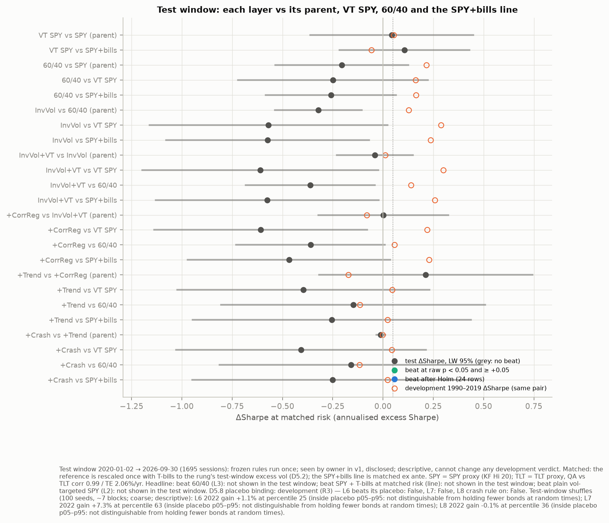
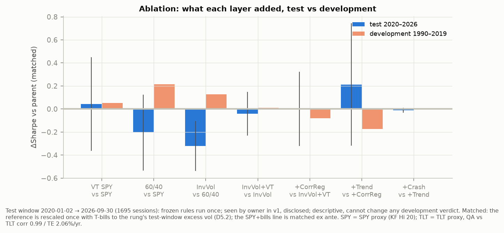
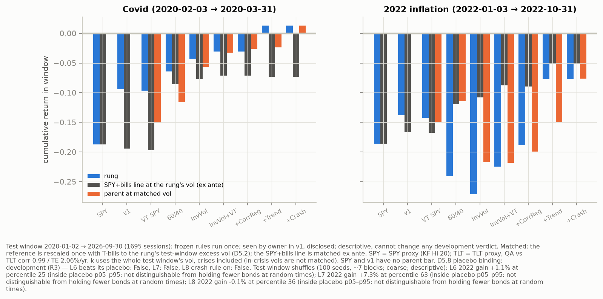
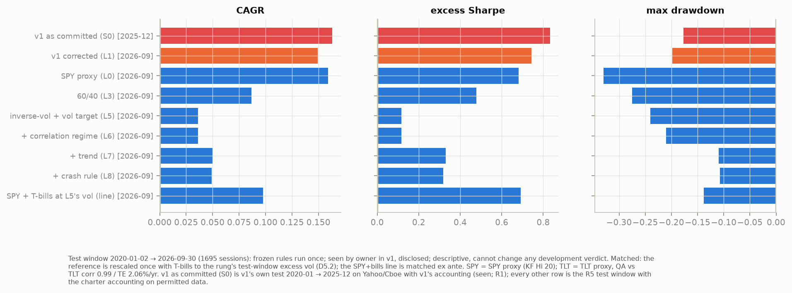
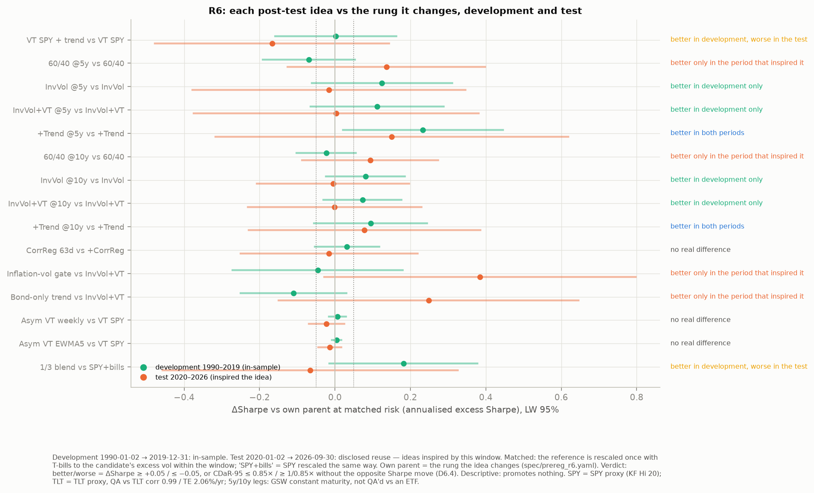
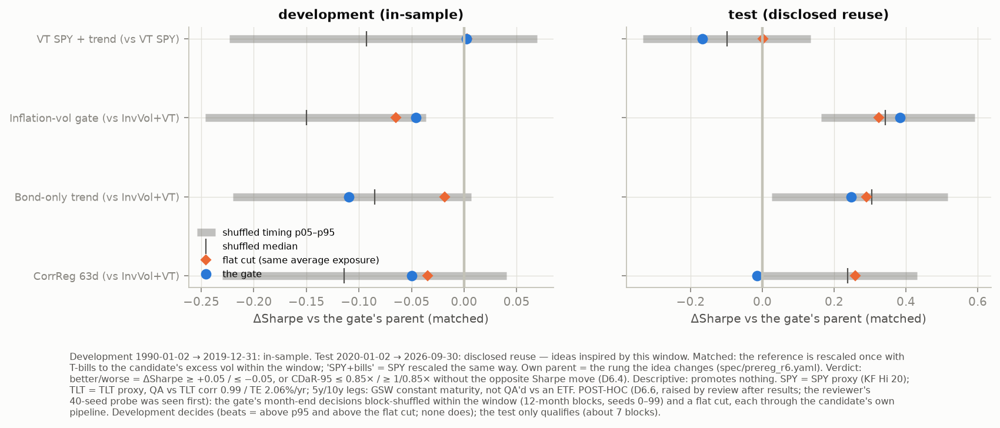

# Regime-aware SPY/TLT/cash allocation (v2)

**Answer: no layer beat plain vol-targeted SPY, a 60/40 mix, or SPY + T-bills at matched risk.**
- **Development (1990–2019):** adding bonds and risk weighting raised the Sharpe ratio by +0.13 to +0.30 at matched
  volatility. None of it passed the pre-registered promotion rule.
- **Test window (2020-01 → 2026-09):** the bond-holding layers lost to all three benchmarks. The 2022 stock–bond sell-off
  undid the development edge.
- **The regime layer:** the stock–bond correlation switch that the thesis rests on fired too late in 2022 to matter.

> **What this shows**
>
> - **v1's 1.00 Sharpe was mostly vol-targeted SPY plus same-close trading.** Vol-targeted SPY alone (L2) earns 0.73
>   on the test window against v1 corrected's 0.74. Trading at the next close instead of the same close cost v1 0.13
>   Sharpe on its own test (§4).
> - **Stock–bond mixes won 1990–2019 because rates fell, and 2022 reversed it.** In development, 60/40 beat SPY at matched
>   volatility by +0.22 Sharpe and inverse-vol beat 60/40 by +0.13. On 2020–2026 both rows turned negative (−0.20,
>   −0.32), as did every comparison of a bond-holding rung against vol-targeted SPY, 60/40 or the line (§1–2).
> - **A slow correlation signal can't react to a fast regime change; trend did.** The 126-day stock–bond correlation
>   first moved bonds to cash at the end of August 2022. The 10-month trend rule had TLT out from January (§3).
> - **Ideas tried after the test (R6, exploration) didn't beat vol-targeted SPY.** The bond switches built for 2022 (an
>   inflation-volatility gate, bond-only trend) did no better than random timing or simply holding fewer bonds; only
>   trend on a shorter bond leg improved its parent in both periods (§6).
> - **The simplest risk control held up.** On 2020-01 → 2026-09, vol-targeted SPY earned 14.7%/yr against SPY's 15.9%,
>   with 16.8% vs 20.5% volatility and a −20.2% vs −33.0% max drawdown; its edge over SPY + T-bills at matched risk
>   (+0.11 Sharpe) is not statistically significant (§1–2).

This is a research repository. It is not a trading system and not investment advice. It rebuilds an earlier project
(v1, kept in git history) with correct accounting, storage-permitted data and a pre-registered test. Every number
below is in a committed file under `reports/`, and every figure is in `reports/figures/`.

---

## 1. The answer

The three questions are registered in `spec/prereg.yaml` (`r5_test.family`).
- In development (1990–2019), "beat" means the pre-registered four-part promotion rule (`promotion_rule`).
- In the test window (2020-01-02 → 2026-09-30, 1,695 sessions), "beat" means ΔSharpe ≥ +0.05 at matched risk
  **and** a Holm-adjusted one-sided p < 0.05 across the 24 registered comparisons.

| Did any layer beat … | Development 1990–2019 | Test 2020-01 → 2026-09 |
|---|---|---|
| (a) plain vol-targeted SPY (L2) | No promotion. Point estimates favoured the bond mixes: L5 vs L2 **+0.30** ΔSharpe at matched vol | **Not shown.** Best row L3 vs L2 −0.25; L5 vs L2 −0.61 [−1.20, −0.02] |
| (b) 60/40 (L3) | No promotion. L5 vs L3 +0.14; L7 vs L3 −0.12 | **Not shown.** Best row L7 vs L3 −0.15; L5 vs L3 −0.36 [−0.68, −0.04] |
| (c) SPY + T-bills at matched risk (the "line") | No promotion. L3 +0.17 [+0.01, +0.32], L5 +0.26 [−0.04, +0.55] | **Not shown.** Best row L2 +0.11 (p 0.20); L5 −0.58 [−1.13, −0.02] |

ΔSharpe is the annualised excess-Sharpe difference at matched volatility, with the Ledoit–Wolf 95% interval.

**What decided it:**
- **Development.** The parent chains, SPY → 60/40 → inverse-vol → vol target → regime layers, stop at the first step.
  60/40 beats SPY on Sharpe but loses inside the 1994 and Q4 2018 crisis windows (a registered robustness leg). The
  pre-registered walk (L1 → L5) stops at L2.
  - Seat: SPY on the parent chains; v1 on the pre-registered walk.
  - Sources: `reports/r2/ladder.json`, `ladder_chains.json`.
- **Test.** The 2020–2026 window holds the worst long-Treasury drawdown in the sample (2022). Every row where bonds or
  risk weighting helped in development flips sign: only 4 of the 24 comparisons agree in sign with development.
  - The test window cannot promote or demote anything. It was run once with frozen rules.
  - It is labelled **"seen by owner in v1, disclosed"**: the owner saw 2020–2025 when v1 was built.
- **Power.** 6.75 years was never going to confirm an edge. The best development layer, 60/40 vs SPY, needs about 30
  years of data for 80% power; inverse-vol vs 60/40 needs 87 (`reports/r4/power.csv`). A "not shown" is therefore the
  expected result even for a real edge. Read it as "the edge did not survive this window", not "proved zero".



## 2. The ladder and what each layer added

Each rung adds one layer to its parent. Parameters are fixed from the literature, not searched (`spec/rules.yaml`).
Every book trades at the next close, earns T-bills on cash, pays bills + 25 bp on borrowing, and pays 3 / 2 bp per side
on true traded turnover.

| Rung | Layer | Dev Sharpe | Dev ΔSharpe vs parent [95%] | Test Sharpe | Test ΔSharpe vs parent [95%] |
|---|---|---|---|---|---|
| L0 | SPY proxy | 0.48 | — | 0.68 | — |
| L1 | v1, corrected (comparison row) | 0.51 | — | 0.74 | — |
| L2 | vol-targeted SPY (v1's real driver) | 0.53 | +0.05 vs L0 | 0.73 | +0.04 [−0.36, +0.45] |
| L3 | 60/40 SPY/TLT, monthly, 5 pp band | 0.69 | **+0.22 [+0.05, +0.38]** vs L0 | 0.48 | −0.20 [−0.54, +0.13] |
| L4 | inverse-vol (63-day) | 0.82 | +0.13 [−0.04, +0.30] | 0.16 | **−0.32 [−0.54, −0.11]** |
| L5 | + 10% portfolio vol target | 0.83 | +0.01 [−0.04, +0.06] | 0.12 | −0.04 [−0.23, +0.15] |
| L6 | + correlation regime (TLT → cash when 126-day corr > 0) | 0.75 | −0.08 [−0.23, +0.07] | 0.12 | +0.00 [−0.32, +0.32] |
| L7 | + per-asset trend (10-month SMA) | 0.58 | −0.17 [−0.42, +0.08] | 0.33 | +0.21 [−0.32, +0.74] |
| L8 | + crash rule (drawdown brake) | 0.58 | −0.00 [−0.01, +0.00] | 0.32 | −0.01 [−0.03, +0.01] |

- Development ΔSharpe is at matched vol (`reports/r3/ablation.csv`, `ablation_context.csv`; L2 from
  `reports/r2/ablation.csv`). Test numbers are from `reports/r5/family.csv` and `metrics.csv`.
- Placebos: neither the correlation gate nor the trend gate beat its block-shuffled placebo in development
  (`reports/r3/placebo.csv`), and the crash rule's judge is off (`reports/r3/crash.json`).



## 3. Crises at matched risk (COVID and 2022)

The table shows cumulative return inside each window, for the rung and for SPY + T-bills held at the rung's own
volatility (ex ante). Source: `reports/r5/crisis.csv`.

| Rung | COVID 2020-02 → 03 | its line | 2022-01 → 10 | its line |
|---|---|---|---|---|
| SPY (L0) | −18.7% | −18.7% | −18.6% | −18.6% |
| 60/40 (L3) | −6.4% | −8.6% | **−24.1%** | −11.9% |
| inverse-vol + vol target (L5) | −3.0% | −7.1% | **−22.4%** | −8.8% |
| + correlation regime (L6) | −3.0% | −7.1% | −18.8% | −8.9% |
| + trend (L7) | **+1.3%** | −7.3% | −7.7% | −5.2% |
| + crash rule (L8) | +1.3% | −7.3% | −7.7% | −5.2% |

- **COVID:** long Treasuries hedged as designed. The trend rule moved SPY to cash at the February 2020 month-end and
  missed most of March.
- **2022:** stocks and bonds fell together, the case the correlation regime was meant for.
  - The 126-day correlation stayed negative at every month-end through July 2022. The gate first moved TLT to cash at
    the 2022-08-31 decision, after most of the bond loss.
  - L6's 2022 gain over L5 (+1.1 pp at matched risk) sits at the 25th percentile of 100 test-window shuffles of the same
    gate, inside their 5–95% range. That is **not distinguishable from holding fewer bonds at random times.**
  - Trend did the 2022 work: TLT was out from January.
  - Shuffles are coarse (about 7 blocks), descriptive and one-directional (D5.8).



## 4. v1 vs v2

v1 reported a 1.00 Sharpe on 2020–2025 (its own definition, without the risk-free rate). R1 replayed v1 exactly, then
applied the accounting corrections one at a time on v1's own test window (`reports/r1/reconciliation.csv`).

| Step | Correction | CAGR | excess Sharpe | Δ excess Sharpe |
|---|---|---|---|---|
| S0 | v1 as committed (Yahoo + Cboe VIX, same-close trading, 0% cash, no financing) | 16.3% | 0.83 | — |
| S1 | trade at t+1 | 14.0% | 0.70 | −0.13 |
| S2 | cash at T-bills, financing above 1× | 13.4% | 0.67 | −0.03 |
| S3 | costs on true traded turnover (incl. vol-scaling trades; 26.7×/yr) | 14.1% | 0.71 | +0.04 |
| S4 | excess-return Sharpe, standard Sortino (metric only) | 14.1% | 0.71 | 0 |
| S5 | no shorts | 14.0% | 0.70 | −0.00 |
| S6 | VIX → realised-vol proxy | 14.0% | 0.70 | −0.01 |
| S7 | permitted data (KF Hi 20, GSW 25-year, H.15) = **L1** | 15.5% | 0.78 | +0.08 |

On the R5 test window (2020-01 → 2026-09), v1 corrected (L1) earns 14.9% CAGR with an excess Sharpe of 0.74. v2's
regime-aware mix with trend (L7) earns 5.0% at a Sharpe of 0.33, with a −11% max drawdown against v1's −20% and
SPY's −33%. v1's edge was mostly vol-targeted SPY: L2 alone has an excess Sharpe of 0.73. Neither v1 nor L2 beats SPY +
T-bills at matched risk in development (L1 −0.08, L2 −0.06).



## 5. Robustness, costs and multiple testing

- **Costs and financing.** At 3× costs, each layer's test ΔSharpe vs its parent moves by ≤ 0.013, except L2 vs L0
  (−0.04; it trades 10×/yr). A +75 bp financing stress changes nothing for L3–L8, which never borrow
  (`reports/r5/costs.csv`; development in `reports/r4/costs.csv`).
- **Deflated Sharpe.** N comes from the development register (`reports/variants.csv`, `reports/r4/dsr.csv`).
  - In development, 787 trial series, including v1's 648-config grid, cluster to an effective N of 3 (N used 4).
  - On the test, with N 5 (one more for the post-hoc 10-year row below), the DSR of every rung is below 0.95:
    SPY 0.72, v1 0.76, L5 0.19, L7 0.37.
  - At the raw register count (751), every test DSR is ≤ 0.11.
- **Post-hoc 10-year bond leg (owner lead from R4).** It cannot change a verdict and is counted in N. On the test the
  10-year leg leaves L5 unchanged (Sharpe 0.115 vs 0.116) and helps L6 (0.30 vs 0.12) and L7 (0.41 vs 0.33).
  - Source: `reports/r5/sens10y.csv`.
  - The 10-year GSW leg is not QA'd against an ETF. The 25-year books are the official ones.
- **Development robustness** (`reports/r4/`): leave-one-crisis-out, decades, rolling 5-year, band and calendar, the zoo
  rows (HMM / jump gates, min-CDaR, vol-model zoo, v1's signals as overlays, GBM risk sizing). No zoo row is
  distinguishable from L5: the largest gains are min-CDaR +0.02 [−0.11, +0.16] and raw GBM sizing +0.01; the rest are
  negative (`reports/r3/ablation.csv`, `reports/r4/zoo.csv`).

## 6. Improvements tried after the test (R6)

**Answer: none of the 15 ideas beat vol-targeted SPY or SPY + T-bills on 2020–2026, the period that suggested them.**
- **Better than their own parent in both periods:** only the trend rung on a shorter (5- or 10-year) bond leg. Even
  then, only the 5-year version's development interval excludes zero, and both still trail vol-targeted SPY on
  2020–2026.
- **The 2022-inspired bond switches:** the inflation-volatility gate and bond-only trend did no better than switching
  bonds out at random times, or than simply holding fewer bonds all the time.

Every idea came from looking at R5's test results, so treat these numbers as exploration, not evidence:
- the test window (2020-01 → 2026-09) is **disclosed reuse: ideas inspired by this window**;
- development (1990–2019) is **in-sample**;
- nothing here promotes, demotes or re-seats any rung.

Each idea is compared with the one rung it changes (its "own parent"), at the same volatility. "Better" means Sharpe up
by at least 0.05, or CDaR-95 at least 15% lower without a Sharpe loss of 0.05 or more. The rules, parameters and verdict
words were registered in `spec/prereg_r6.yaml` (sha256 in `reports/ledger.md`) before any number.

After the review, the owner added two things, logged as post-hoc:
- the phrase "worse in development, better in the test";
- the "interval excludes 0?" and "test power" columns.

Every row counts in the multiple-testing N.

| Idea | Own parent | ΔSharpe 1990–2019 [95%] | ΔSharpe 2020–2026 [95%] | Verdict | Interval excludes 0? (dev / test) | Test power |
|---|---|---|---|---|---|---|
| VT SPY + SPY trend (10-month SMA) | VT SPY (L2) | +0.00 [−0.16, +0.16] (CDaR 0.59×) | −0.17 [−0.48, +0.14] | better in development, worse in the test | no / no | 0.05 |
| 60/40, 5-year bond leg | 60/40 (L3) | −0.07 [−0.19, +0.05] | +0.14 [−0.13, +0.40] | worse in development, better in the test | no / no | 0.02 |
| Inverse-vol, 5-year leg | inverse-vol (L4) | +0.12 [−0.06, +0.31] | −0.02 [−0.38, +0.35] | better in development only | no / no | 0.18 |
| Inverse-vol + vol target, 5-year leg | InvVol + VT (L5) | +0.11 [−0.06, +0.29] | +0.00 [−0.37, +0.38] | better in development only | no / no | 0.16 |
| + trend (L7), 5-year leg | + trend (L7) | +0.23 [+0.02, +0.45] | +0.15 [−0.32, +0.62] | better in both periods | yes / no | 0.29 |
| 60/40, 10-year leg | 60/40 (L3) | −0.02 [−0.10, +0.05] | +0.09 [−0.09, +0.27] | better only in the period that inspired it | no / no | 0.03 |
| Inverse-vol, 10-year leg | inverse-vol (L4) | +0.08 [−0.02, +0.19] | −0.00 [−0.21, +0.20] | better in development only | no / no | 0.19 |
| Inverse-vol + vol target, 10-year leg | InvVol + VT (L5) | +0.07 [−0.03, +0.18] | −0.00 [−0.23, +0.23] | better in development only | no / no | 0.17 |
| + trend (L7), 10-year leg | + trend (L7) | +0.09 [−0.06, +0.24] | +0.08 [−0.23, +0.39] | better in both periods | no / no | 0.16 |
| Correlation gate, 63-day window | corr. gate (L6) | +0.03 [−0.05, +0.12] | −0.02 [−0.25, +0.22] | no real difference | no / no | 0.10 |
| Inflation-volatility gate (BLS CPI) | InvVol + VT (L5) | −0.05 [−0.27, +0.18] (CDaR 1.59×) | +0.38 [−0.03, +0.80] | worse in development, better in the test | no / no | 0.03 |
| Trend on bonds only | InvVol + VT (L5) | −0.11 [−0.25, +0.03] | +0.25 [−0.15, +0.65] | worse in development, better in the test | no / no | 0.01 |
| Asymmetric vol target, weekly step-ups | VT SPY (L2) | +0.01 [−0.02, +0.03] | −0.02 [−0.07, +0.02] | no real difference | no / no | 0.09 |
| Asymmetric vol target, EWMA step-ups | VT SPY (L2) | +0.00 [−0.01, +0.02] | −0.01 [−0.04, +0.02] | no real difference | no / no | 0.10 |
| ⅓ each VT SPY, 60/40, + trend | SPY + T-bills | +0.18 [−0.01, +0.38] | −0.07 [−0.46, +0.33] | better in development, worse in the test | no / no | 0.22 |

Counts: better in both periods 2 (1 with a development interval excluding 0), better in development only 4, better in
development / worse in the test 2, worse in development / better in the test 3, better only in the period that inspired
it 1, no real difference 3. **No test-window interval excludes 0; test power is 0.01–0.29.**

**What this shows**
- **The bond switches built for 2022 are "fewer bonds", not timing.**
  - The inflation-volatility gate added +0.38 Sharpe on 2020–2026, and bond-only trend +0.25.
  - Shuffling each switch's monthly decisions at random (100 times) gave a median of +0.34 and +0.30. Holding a flat,
    always-on share of bonds of the same average size gave +0.32 and +0.29.
  - In 1990–2019 both switches lost to their parent. The inflation gate even pulled bonds out during the 2008–09
    crisis, when they hedged (CDaR 1.59×).
  - No switch's timing beat random timing and a flat cut in development (post-hoc placebo, `reports/r6/placebo.csv`).
- **A shorter bond leg helps only next to the trend rule.**
  - Swapping the 25-year leg for a 5- or 10-year one helped the + trend rung in both periods: +0.23 / +0.15 and
    +0.09 / +0.08.
  - It did nothing for inverse-vol or vol-targeted rungs on the test.
  - Even the better trend rung trails vol-targeted SPY on 2020–2026 at matched risk (−0.25 at 5 years).
- **Trend on vol-targeted SPY trades drawdown for whipsaws.**
  - In 1990–2019 it cut the drawdown risk of vol-targeted SPY (max DD −48% → −29%) at the same Sharpe.
  - On 2020–2026, five one-month exits during sharp rebounds cost more than the 2022 exit saved.
- **Slower step-ups cut vol-targeting turnover by 22–29% without changing its Sharpe.** This is the only cost idea, and
  it is cheap at 3 bp a side either way.
- **Against the benchmarks on 2020–2026, nothing beats vol-targeted SPY or SPY + T-bills by +0.05.** Several ideas beat
  60/40 on the test: asymmetric VT +0.23, the ⅓ blend +0.14, 60/40 on a 5-year leg +0.14.

Multiple testing:
- The largest test-window deflated Sharpe ratio is 0.48, with N = 20 (R5's 5 plus the 15 R6 rows). None reaches 0.95.
- Gold as a fourth sleeve (R6g) was not run: the repo has no monthly-frequency engine.
- CPI comes directly from the BLS (public domain), not from FRED.




Tables: `reports/r6/` (`verdict.csv`, `compare.csv`, `placebo.csv`, `metrics.csv`, `crisis.csv`, `costs.csv`, `dsr.csv`).
To reproduce, see §9.

## 7. Method

- **Windows:**
  - warm-up 1986–1989 (estimation only);
  - development 1990–2019 (every decision);
  - test 2020-01 → the last Ken French month at R5 (2026-09), frozen rules run once.

  The ex-ante line is `quantkit.bench.vol_matched`; the test-window comparisons are rescaled once ex post to the
  child's test-window vol.
- **Pre-registration:** `spec/prereg.yaml` was hashed into `reports/ledger.md` before every phase's results.
  Expectations were written before code, and every miss was logged and diagnosed, never hidden: R5 shows 13 held and
  5 failed.
- **Freeze:**
  - `spec/freeze.lock.json` holds content hashes of the spec, the engine, the run inputs and the data.
  - `reports/r5/test_run.json` was written "started" before any statistic and "completed" after.
  - `make r5-replay` recomputes every test table byte for byte.
- **Decisions:** each design choice went to an independent advisor before acting (`reports/decisions.md`; plain
  language in `learn/decisions.md`). Each phase had one adversarial review (`reports/reviews/`).
- **Library:** `quantkit` v0.19.2 (statistics, vol models, ladder, bonds, figures), pinned with a per-module hash check.

## 8. Data and licences

v2 uses only sources whose terms permit local storage. See `LICENSES.md` for the quoted clauses.

| Leg | Source | Label |
|---|---|---|
| SPY sleeve | Ken French data library, daily "Hi 20" size portfolio (value-weighted total return) | "SPY proxy"; gitignored, never redistributed |
| TLT sleeve | 25-year constant-maturity Treasury total return from the Fed's GSW yield curve (public domain), via `quantkit.bonds` | "TLT proxy, QA vs TLT corr 0.99 / TE 2.06%/yr" |
| Cash, financing | Fed H.15 3-month bill (public domain) | — |

- **Why the switch:** v1 used Yahoo Finance prices and Cboe VIX; both were removed from the repository and its history.
  Those providers' terms bar automated collection and redistribution. Realised volatility and vol-model forecasts
  replace VIX.
- **Committed vs local:** only derived statistics are committed. Daily series and curve figures stay local
  (`data/`, `reports/figures_local/`, gitignored).

## 9. Reproduce

macOS with Homebrew and [uv](https://docs.astral.sh/uv/). The LightGBM risk-sizing row (R4) links Homebrew's OpenMP
runtime. `make omp` points scikit-learn's bundled copy at the same runtime inside `.venv` only, so both libraries load
one copy (quantkit's documented `python -m quantkit.omp --fix`; reversible). Re-run `make omp` after every `uv sync`.

```zsh
brew install libomp
uv sync --frozen
make omp
make doctor
make fetch
make all
make report-site-local
make -f Makefile.r6 r6-data
make -f Makefile.r6 all
```

- `make fetch` downloads Ken French, GSW and H.15 into `data/raw/` with a manifest of hashes.
- `make all` builds the panel, runs the tests, the ladder (R2–R4) and `make r5-replay` (the test window recomputed and
  checked byte for byte against `reports/r5/`), then draws the figures and `reports/site/index.html`.
- A fresh Ken French download that adds a month after 2026-09 fails the freeze lock on purpose. The test window is
  frozen.
- R6 (§6) has its own `Makefile.r6`, because R5's `Makefile` is locked by its freeze. `make -f Makefile.r6 r6-data`
  fetches CPI from the BLS once. `make -f Makefile.r6 all` then runs the R6 ideas, draws `reports/figures/R6/` and
  rebuilds the page. `make freeze-verify` still prints "freeze OK".
- `make -f Makefile.r6 r6-figures-local` draws R6's local headline figures into the gitignored
  `reports/figures_local/R6/`.
- `make report-site-local` draws the local curve figures (growth of $1, exposure, correlation regime) into the
  gitignored `reports/figures_local/`.

## 10. Limitations

- The SPY and TLT legs are proxies. Ken French Hi 20 is a value-weighted large-cap portfolio, not the ETF; the 25-year
  GSW bond is a constructed constant-maturity Treasury, QA'd against TLT only from 2005.
- One test window of 6.75 years, seen by the owner in v1, and dominated by one regime (the 2022 joint sell-off and the
  higher-rate years after it). It cannot confirm or reject a modest edge.
- The regime layers are simple and lagging by design (a 126-day correlation, a 10-month trend). Faster variants were
  not searched, deliberately: search was the failure the rebuild set out to fix.
